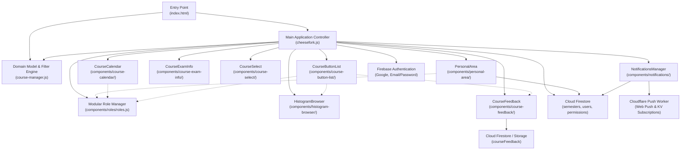

# CheeseMate System & Component Architecture

## 1. High-Level System Overview

**CheeseMate** is an interactive, multi-user schedule planner and academic companion designed for Technion (Israel Institute of Technology) students. It is an evolved fork of the open-source **CheeseFork** schedule engine originally authored by Michael Maltsev.

While the original CheeseFork engine provided client-side single-user schedule visualization and constraint satisfaction (conflict detection, ICS export, and exam schedules), CheeseMate extends the platform into a collaborative social academic network:
- **Collaborative Schedules:** Real-time synchronization of student schedules via Google Cloud Firestore.
- **Friend Schedules & Co-registration Tracking:** Users can add friends, view friend schedules side-by-side, and identify shared lectures/tutorials via visual badges.
- **Course & Event Social Density:** Displays real-time counts of other students and mutual friends attending specific courses and lessons.
- **Modular Role & Permission System:** Fine-grained authorization levels (Standard Student, Administrator, Atmosphere/Special Roles) with distinctive UI styling and hover tooltips.
- **Cross-Platform Push Notifications:** Progressive Web App (PWA) push notifications powered by Cloudflare Workers and Web Push standards, alerting users to incoming friend requests and administrative announcements even when the site is closed.
- **Academic Transition Support:** Dual support for both the legacy Technion Undergraduate catalog format (6-digit course IDs, pre-202401) and the modern Technion SAP/Portalex catalog format (8-digit course IDs, 202401 onward).

---

## 2. Component Relationship Diagram

---

## 3. Core Controller: `cheesefork.js`

### 3.1 Responsibilities
`cheesefork.js` is the primary orchestrator and state coordinator of the client application. It manages:
1. **Application Lifecycle & Bootstrapping:** Reads query parameters (`semester`, `uid`, `course`), initializes Firebase services, mounts UI components, and drives progressive loading.
2. **Session & State Management:** Coordinates the schedule state across local storage (`localStorage`) and Cloud Firestore (`users/{uid}/semesters/{semesterId}`).
3. **Undo/Redo History:** Implements a single-step undo and redo state stack for schedule mutations (adding/removing courses, selecting lesson sections, custom events).
4. **Friend Schedule Mode:** Toggles between the user's active editable schedule and read-only friend schedule views (`watchFriendSchedule` / `returnToOwnSchedule`), intercepting browser history popstate events.
5. **Global Event Aggregation:** Computes co-registration metrics across students (`recomputeCourseStudentCounts`), cross-referencing friend schedules with local course selections.
6. **Schedule Exportation:** Converts in-memory schedule selections into iCalendar (`.ics`) files, downloadable images, and shareable permalinks.
7. **Metadata Change Diffing:** Tracks upstream syllabus and schedule revisions between semesters, highlighting added or canceled lesson times.

### 3.2 State Management & Variables
- `currentSavedSession`: The canonical state of the active schedule for the current semester (course IDs, selected lesson group indices, custom events).
- `ownSavedSession`: A memory backup of the authenticated user's schedule preserved when navigating into a friend's schedule.
- `savedSessionForUndo` / `savedSessionForRedo`: Snapshot buffers enabling one-step undo/redo.
- `viewingSharedSchedule` (boolean): Set to `true` when loading via a public sharing link (`?uid=...`).
- `viewingFriendUid` / `viewingFriendName`: Contextual state when viewing a friend's schedule from the Personal Area.
- `lastSemesterDocsSnapshot`: Cached collection snapshot from Firestore's `collectionGroup('semesters')` used to compute student counts per course.

---

## 4. Domain Engine: `course-manager.js`

### 4.1 Responsibilities
`CourseManager` serves as the domain model for Technion academic courses. It operates independently of DOM rendering and provides data indexing, normalization, parsing, and constraint validation.

### 4.2 Public API & Key Methods

| Method | Signature | Responsibility |
| :--- | :--- | :--- |
| `doesExist` | `(course: string): boolean` | Checks if a course code is present in the loaded semester dataset. |
| `toOldCourseNumber` | `(course: string): string` | Normalizes 8-digit SAP course codes (e.g., `02340118`) to legacy 6-digit codes (`234118`). |
| `toNewCourseNumber` | `(course: string): string` | Converts 6-digit legacy codes to 8-digit zero-padded SAP codes (`0` + faculty + `0` + course). |
| `toSemesterFormatCourseNumber` | `(course: string): string` | Formats course ID according to the active semester format threshold (`< 202401` legacy vs `>= 202401` SAP). |
| `isComputerScienceCourse` | `(course: string): boolean` | Returns true if the course prefix belongs to Computer Science (`23xxxx` or `023xxxxx`). |
| `stringToCourseNumber` | `(str: string): string\|null` | Cleanses and zero-pads user string inputs to a valid course number. |
| `getAllCourses` | `(): string[]` | Returns all course numbers indexed in the current catalog. |
| `getCourseData` | `(course: string): Object` | Returns the raw course record, triggering lazy schedule parsing if not yet processed. |
| `getGeneralInfo` | `(course: string): Object` | Retrieves course metadata (faculty, points, syllabus, exam dates, prerequisites). |
| `getSchedule` | `(course: string): Array` | Parses and caches course lessons and dynamically extracted workshop sessions ("סדנאות"). |
| `parseExamDateTime` | `(strDate: string): Object\|null` | Extracts start and end timestamps from Hebrew/SAP exam date strings. |
| `parseLessonTime` | `(strTime: string): Object\|null` | Extracts 24-hour start and end times (`HH:mm`) from lesson time strings. |
| `filterCourses` | `(filters: Object): string[]` | Multi-criteria search filtering across faculty, study framework, credit points, prerequisites (via `BooleanExpression`), linked co-requisites, overlapping courses, and exam date intervals. |

---

## 5. UI Components (`components/*`)

### 5.1 `CourseCalendar` (`components/course-calendar/`)
- **Lifecycle & Binding:** Wraps FullCalendar (v3) in agenda week view (`hiddenDays: [5, 6]` for Sunday–Thursday). Handles window resizing, slot rendering, custom pinch-to-zoom touch scaling for mobile devices, and lesson event clicks.
- **Communication:**
  - Informs `cheesefork.js` of lesson selections (`onLessonSelected`), unselections (`onLessonUnselected`), and conflict state toggles (`onCourseConflictedStatusChanged`).
  - Receives event-level friend attendance maps (`setEventFriendCounts`) to render mutual student indicators ("shared with me" person icon).

### 5.2 `CourseButtonList` (`components/course-button-list/`)
- **Lifecycle & Binding:** Renders the sidebar list of active courses using jQuery UI Sortable. Provides drag-and-drop course reordering, drag-to-delete drop zone, WhatsApp/Telegram group link dialogs, and student count badges.
- **Communication:**
  - Emits course activation, deactivation, and reordering events to `cheesefork.js`.
  - Integrates modal launchers for `HistogramBrowser` and `CourseFeedback`.

### 5.3 `CourseExamInfo` (`components/course-exam-info/`)
- **Lifecycle & Binding:** Renders exam timelines (Moed A & Moed B) pinned to the sidebar footer. Calculates days between successive exams and flags scheduling conflicts (0 days difference) with highlighted indicators.
- **Communication:** Hovering an exam node highlights the corresponding course in `CourseButtonList` and `CourseCalendar`.

### 5.4 `CourseSelect` (`components/course-select/`)
- **Lifecycle & Binding:** Integrates Selectize.js with a searchable course dropdown. Includes a filter modal dialog allowing users to set credit point limits, exam date ranges, and prerequisite constraints.
- **Communication:** Triggers `onItemAdd` when a course is chosen and broadcasts `onDropdownItemActivate`/`onDropdownItemDeactivate` to preview courses on the schedule grid without formally adding them.

### 5.5 `CourseFeedback` (`components/course-feedback/`)
- **Lifecycle & Binding:** Manages student course reviews and ratings (lecturer, TA, homework difficulty, overall impression). Uses BootstrapDialog for new review submissions and report filing.
- **Communication:** Connects to Cloud Firestore collection `courseFeedback` to persist and load verified feedback posts.

### 5.6 `HistogramBrowser` (`components/histogram-browser/`)
- **Lifecycle & Binding:** Renders semester-by-semester exam grade distribution tables and average statistics.
- **Communication:** Pulls historical exam grade data; features a share-histograms promotion banner encouraging community data contributions.

### 5.7 `PersonalArea` (`components/personal-area/`)
- **Lifecycle & Binding:** Modal dialog managing user identity, custom display names, incoming/outgoing friend requests, and active friend list.
- **Communication:**
  - Maintains real-time listener on `users/{uid}`.
  - Queries `RoleManager` to decorate friend entries with role descriptions and gradient styling.
  - Exposes `window.cheeseMateViewFriendSchedule` allowing one-click friend schedule inspection.

### 5.8 `NotificationsManager` (`components/notifications/`)
- **Lifecycle & Binding:** Renders the top-navbar notification bell dropdown and unread counter badge. Manages browser Web Push registration via `/sw.js`.
- **Communication:**
  - Subscribes to `users/{uid}/notifications` collection in real-time.
  - Syncs browser PushSubscription tokens with the Cloudflare Worker `/subscribe` endpoint.

### 5.9 `RoleManager` (`components/roles/roles.js`)
- **Lifecycle & Binding:** Central registry of permission levels (0: Standard Student, 1: Administrator, 2: Atmosphere / Special Roles).
- **Communication:**
  - Dynamically loads role definitions from Firestore collection `permissionLevels`.
  - Provides `applyRoleHover($el, userOrLevel)` to consistently bind tooltips and gradient CSS classes across all components displaying user names.
