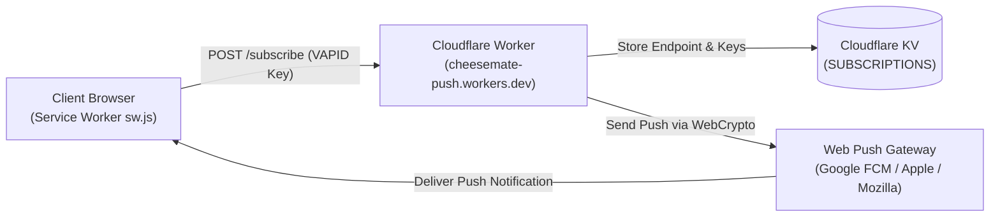
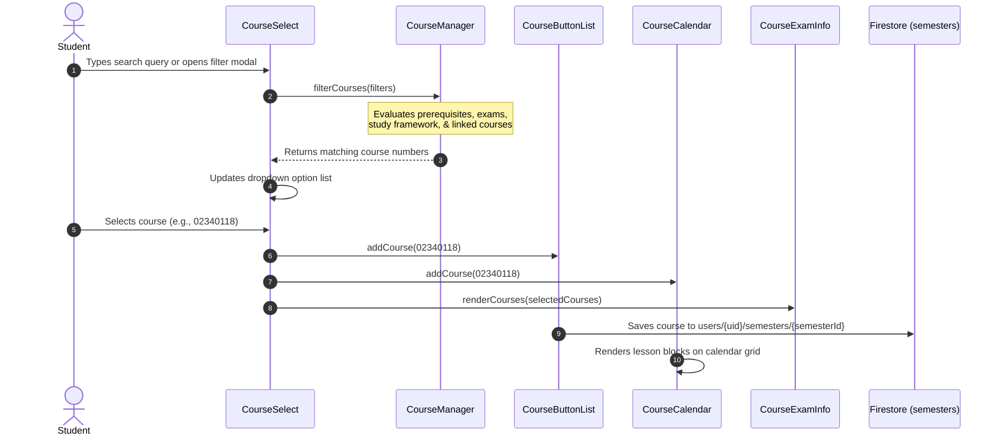
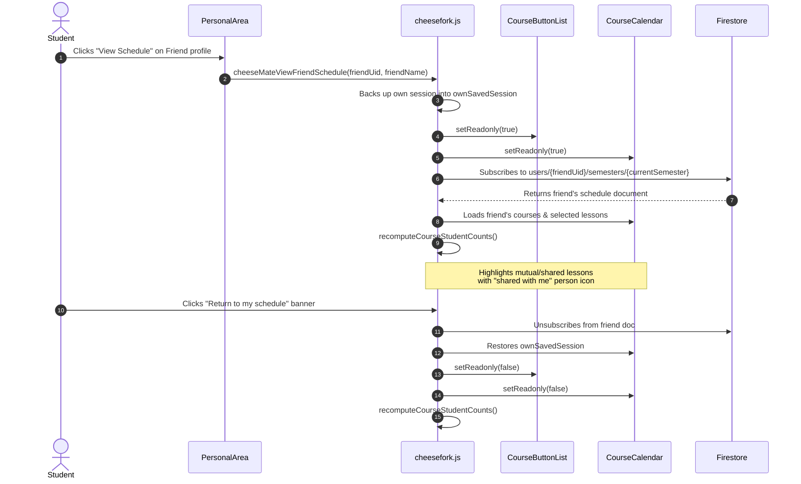
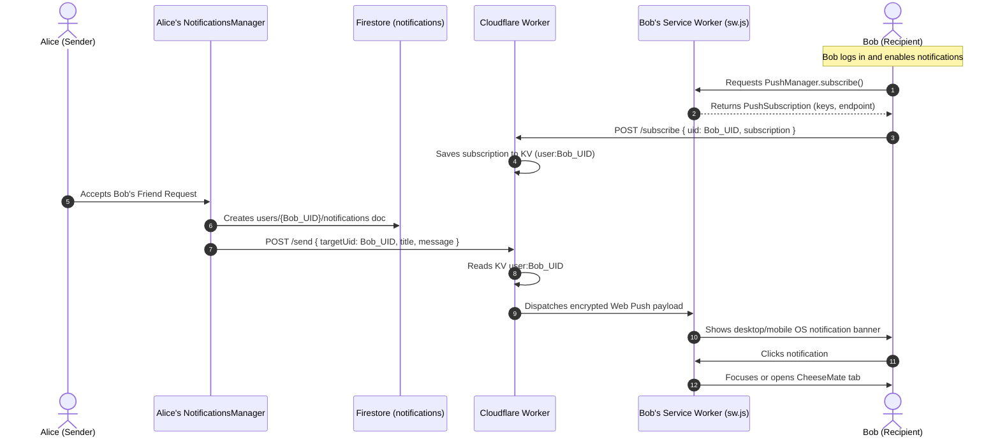

# CheeseMate Data Flow, Firestore Schema & Backend Architecture

## 1. Cloud Firestore Data Model

CheeseMate utilizes Google Cloud Firestore as its primary real-time database. The schema is organized into root collections and sub-collections structured to balance data privacy with real-time collaborative queries.

```
Firestore Root
├── users/ (Collection)
│   └── {userId}/ (Document: User Profile & Friends)
│       ├── semesters/ (Sub-collection)
│       │   └── {semesterId}/ (Document: Schedule Selections per Semester)
│       └── notifications/ (Sub-collection)
│           └── {notificationId}/ (Document: Individual Notification)
├── permissionLevels/ (Collection: Dynamic Role & Privilege Registry)
│   └── {levelId}/ (Document: Role Definition, e.g. "0", "1", "2")
├── courseFeedback/ (Collection: Course Reviews)
│   └── {courseId}/ (Document: List of Student Review Posts)
└── courseFeedbackReports/ (Collection: Review Moderation Reports)
    └── {courseId}/ (Document: Abuse/Moderation Reports)
```

### 1.1 Document Specifications

#### Collection: `users/{userId}`
*Document ID:* Firebase Auth UID (`request.auth.uid`).
*Security:* Public read (to allow schedule sharing and friend lookup). Owner update with strict field validation (`hasOnlyAllowedFields`). Privilege level (`level`) can only be modified by administrators.

| Field | Type | Description |
| :--- | :--- | :--- |
| `uid` | `string` | User's Firebase Auth UID. |
| `displayName` | `string` | Public display name inherited from Auth or custom profile. |
| `username` | `string` | Custom chosen username within Personal Area. |
| `usernameLower` | `string` | Lowercase username for case-insensitive friend lookup. |
| `email` | `string` | User email address. |
| `level` | `number` | Authorization level (`0`: User, `1`: Admin, `2`: Atmosphere/Special). |
| `friends` | `string[]` | UIDs of confirmed mutual friends (max 500). |
| `incomingRequests` | `string[]` | UIDs of pending incoming friend requests. |
| `outgoingRequests` | `string[]` | UIDs of sent friend requests awaiting confirmation. |
| `pushSubscriptions` | `map[]` | (Optional) Active Web Push subscriptions cached on the profile. |
| `lastSeen` | `timestamp` | Server timestamp updated upon user session initialization. |

#### Sub-collection: `users/{userId}/semesters/{semesterId}`
*Document ID:* Academic semester identifier (e.g., `"202601"`).
*Security:* Public read (to enable viewing shared schedules via `?uid={userId}`). Writable only by document owner (`isOwner(userId)`).
*Indexed by Collection Group:* Indexed globally via `collectionGroup('semesters')` to compute aggregate course enrollment density.

| Field | Type | Description |
| :--- | :--- | :--- |
| `displayName` | `string` | Public name attached to the schedule snapshot. |
| `{semester}_courses` | `string[]` | Ordered list of enrolled course codes (e.g. `["02340118", "01040031"]`). |
| `{semester}_{courseId}` | `map` | Key-value map of selected lesson groups (e.g. `{"lecture": "10", "tutorial": "11"}`). |
| `{semester}_custom_events` | `map` | User-defined custom schedule blocks (title, start, end, days). |
| `{semester}_metadata_{courseId}` | `map` | Cached syllabus and lesson time snapshot for change-detection diffing. |

#### Sub-collection: `users/{userId}/notifications/{notificationId}`
*Document ID:* Auto-generated Firestore ID.
*Security:* Read/list restricted to the recipient (`isOwner(userId)`) and Admins. Create allowed for authenticated users sending to the recipient.

| Field | Type | Description |
| :--- | :--- | :--- |
| `type` | `string` | Notification type: `'friend_request_received'`, `'friend_request_accepted'`, `'system_broadcast'`, `'system_direct'`, `'update'`, `'alert'`. |
| `fromUid` | `string` | Sender Firebase Auth UID. |
| `fromUsername` | `string` | Sender display name. |
| `message` | `string` | Notification body text. |
| `timestamp` | `number` | Epoch timestamp in milliseconds. |
| `read` | `boolean` | Unread state indicator (defaults to `false`). |

#### Collection: `permissionLevels/{levelId}`
*Document ID:* Stringified numeric level (e.g. `"0"`, `"1"`, `"2"`).
*Security:* Read allowed for all authenticated users. Create/update/delete restricted to administrators.

| Field | Type | Description |
| :--- | :--- | :--- |
| `level` | `number` | Numeric level identifier. |
| `name` | `string` | Unique role identifier (`user`, `admin`, `atmosphere`). |
| `description` | `string` | Human-readable role label displayed in tooltips (e.g. "א. אווירה", "מנהל מערכת"). |
| `isStandard` | `boolean` | If true, treated as standard user without hover tooltip badge. |
| `badgeClass` | `string` | CSS class for badge rendering. |
| `gradientClass` | `string` | CSS class for gradient name presentation. |

---

## 2. Caching & State Layers

### 2.1 In-Memory Caching (`PersonalArea.profilesCache`)
`PersonalArea` maintains an in-memory dictionary mapping `uid -> UserProfileDoc`. This cache stores user display names, email addresses, and permission levels.
- **Problem Identified in Audit:** Cache entries were previously bypassed in `loadReferencedProfiles`, causing repeated `.get()` network calls for known friends on every snapshot event.
- **Target Behavior:** Check `profilesCache[uid]` before issuing remote requests; only un-cached UIDs trigger Firestore document reads.

### 2.2 Local Storage Fallback
When running offline, signed out, or in private browsing sessions:
- `lastSelectedSemester`: Stores the last visited academic term.
- `dontShowIntro`: Timestamp flag suppressing the first-time user tutorial.
- Schedule sessions fallback to `localStorage` when Firebase Authentication is unavailable.

---

## 3. Cloudflare Worker & Push Notifications



1. **VAPID Public Key Registration:** Browser requests registration via `/sw.js` with public key `BKg-LrqshpQPZ...`.
2. **Subscription Storage:** Worker persists up to 10 active endpoints per user in Cloudflare KV under the key `user:{uid}`.
3. **Push Dispatch:** When an event occurs (friend request accepted, admin announcement), the client or backend triggers `POST /send` on the worker with `targetUid`, which retrieves the subscription from KV, encrypts the payload using `@block65/webcrypto-web-push`, and delivers it to the device push gateway.

---

## 4. End-to-End Sequence Diagrams

### 4.1 Course Filtering & Schedule Rendering



---

### 4.2 Friend Schedule Viewing & Synchronization



---

### 4.3 Web Push Notification Subscription & Dispatch


