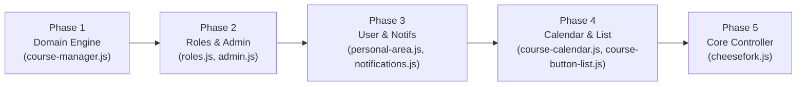

# CheeseMate Refactoring Roadmap & Quality Plan

This document establishes the official tracking register for known architectural issues, critical bugs, and algorithmic bottlenecks identified during the codebase review. It defines the phased refactoring schedule, acceptance criteria, and verification procedures.

---

## 1. Issue & Bottleneck Register

| ID | File / Component | Category | Severity | Description |
| :--- | :--- | :--- | :--- | :--- |
| **BUG-01** | `course-manager.js` | Correctness | **Critical** | Inverted boolean logic in linked courses ("מקצועות צמודים") filtering; courses without met co-requisites pass while valid ones can be dropped. |
| **BUG-02** | `cheesefork.js` | Correctness / UI | **Medium** | `recomputeCourseStudentCounts` is not called when entering or exiting friend schedule view (`watchFriendSchedule` / `returnToOwnSchedule`), causing shared event indicators to lag. |
| **BUG-03** | `course-calendar.js` | Memory / Leaks | **Medium** | Touch event listeners in `initTouchScalingSupport` are attached to individual `event.target` nodes and may fail to unbind if the DOM node is detached during a gesture. |
| **PERF-01** | `course-manager.js` | Algorithmic | **High** | Multi-criteria search (`filterCourses`) runs $O(N \times M)$ linear scans (`indexOf`) on large arrays for ~2,500 courses. |
| **PERF-02** | `personal-area.js` | Network / DB | **High** | `loadReferencedProfiles` re-queries Firestore via individual `.get()` calls for *all* friend UIDs on every user snapshot, ignoring existing `profilesCache` entries. |
| **PERF-03** | `personal-area.js` | Network / DB | **Medium** | `searchUsers` performs full collection scan (`db.collection('users').get()`) without debouncing or bounded queries. |
| **PERF-04** | `cheesefork.js` | Redundant Compute | **Low** | `recomputeCourseStudentCounts` checks `Array.isArray(friendCourses)` and loops through it twice consecutively; `coursePrefixForHashCalc` dictionary is reallocated on every color generation call. |
| **PERF-05** | `roles.js` / UI components | DOM Thrashing | **Medium** | Frequent invocation of `$el.tooltip('dispose')` and tooltip recreation inside iterative rendering loops triggers costly layout recalculations. |
| **ARCH-01** | `admin.js` vs `roles.js` | DRY / SOLID | **Medium** | `admin.js` maintains its own duplicate `permissionLevelsMap` rather than delegating directly to `RoleManager`. |
| **ARCH-02** | `course-button-list.js` | Clean Code | **Low** | `addCourse` is a monolithic 200-line method interweaving DOM generation, tooltip setup, Firestore group link listeners, and sortable registration. |

---

## 2. Refactoring Phases

---

### Phase 1: Domain Model & Engine (`course-manager.js`)
*Scope:* `course-manager.js`
*Target Improvements:*
1. **Fix BUG-01 (Linked Courses Filter):** Rewrite the co-requisite validation loop so that a linked course is satisfied if and only if it is present in either `coursesTaken` OR `coursesCurrent`. Properly handle edge cases where either filter set is undefined or empty.
2. **Optimize PERF-01 ($O(1)$ Filter Lookups):** Convert `coursesLimit`, `coursesExclude`, `coursesTaken`, `coursesCurrent`, and `faculties` arrays into `Set` instances at the entry of `filterCourses`.
3. **Regex Hoisting & Reusability:** Hoist static regular expressions (e.g., course number format patterns, exam date regexes, workshop text normalizers) to module scope to avoid re-compilation on every method invocation.
4. **Documentation & Type Contracts:** Add clear JSDoc annotations to all prototype methods defining parameters, return types, and business constraints.
5. **Preserve Compatibility:** Maintain the ES5 constructor function / prototype pattern and all existing method signatures for callers in `cheesefork.js` and `course-select.js`.

*Acceptance Criteria:*
- A course with linked co-requisites is included if at least one co-requisite is in `coursesTaken` or `coursesCurrent`.
- A course with linked co-requisites is excluded if none of the co-requisites have been taken or are currently selected.
- No change to existing method signatures or external behaviors.
- Catalog filtering execution time is measurably reduced.

---

### Phase 2: Role Management & Admin Integration (`roles.js`, `admin.js`)
*Scope:* `components/roles/roles.js`, `admin/admin.js`
*Target Improvements:*
1. **Resolve ARCH-01:** Eliminate local `permissionLevelsMap` in `admin.js`; route all role queries and formatting through `RoleManager`.
2. **Resolve PERF-05:** Prevent tooltip layout thrashing in `RoleManager.applyRoleHover` by reusing initialized tooltip instances rather than blindly disposing and recreating them on every render.
3. **Clean Error Handling:** Standardize batch commit and error logging in admin operations.

*Acceptance Criteria:*
- Admin dashboard correctly displays role descriptions and badges directly from `RoleManager`.
- Changing permissions updates both the Firestore document and the UI seamlessly.

---

### Phase 3: Personal Area & Notifications (`personal-area.js`, `notifications.js`)
*Scope:* `components/personal-area/personal-area.js`, `components/notifications/notifications.js`
*Target Improvements:*
1. **Resolve PERF-02:** Update `loadReferencedProfiles` to check `this.profilesCache[uid]` before issuing remote `.get()` queries.
2. **Resolve PERF-03:** Add input debouncing (250ms) to user search input in `PersonalArea`. Structure queries cleanly.
3. **Modernize Push Subscription Sync:** Streamline Promise chains and error boundaries in `NotificationsManager.prototype.syncPushSubscription`.

*Acceptance Criteria:*
- Opening the Personal Area or receiving a friend snapshot produces zero redundant network requests for already-cached profiles.
- Typing in user search does not fire requests on every keystroke.

---

### Phase 4: UI Schedule Components (`course-button-list.js`, `course-calendar.js`)
*Scope:* `components/course-button-list/course-button-list.js`, `components/course-calendar/course-calendar.js`
*Target Improvements:*
1. **Resolve BUG-03:** Fix touch event listener binding in `initTouchScalingSupport` by binding to the persistent calendar container or maintaining a single central touch controller.
2. **Resolve ARCH-02:** Refactor `CourseButtonList.prototype.addCourse` by extracting dedicated sub-functions:
   - `buildCourseItemDOM(course, general)`
   - `bindCourseItemEvents(item, course)`
   - `setupGroupLinkListeners(item, course)`
3. **Conditional Flattening:** Use guard clauses to simplify event click and selection handlers in `course-calendar.js`.

*Acceptance Criteria:*
- Mobile pinch-to-zoom gestures operate smoothly without memory leaks.
- Course list ordering, deletion, and group link modals function identically with cleaner, decoupled code.

---

### Phase 5: Core Application Controller (`cheesefork.js`)
*Scope:* `cheesefork.js`
*Target Improvements:*
1. **Resolve BUG-02:** Invoke `recomputeCourseStudentCounts()` immediately within `watchFriendSchedule` and `returnToOwnSchedule`.
2. **Resolve PERF-04:** Consolidate sequential friend course loops in `recomputeCourseStudentCounts`; hoist `coursePrefixForHashCalc` dictionary outside `courseColorGenerator`.
3. **Dead Code Removal:** Strip verified unused local variables and old legacy commented-out snippets.

*Acceptance Criteria:*
- Switching between personal schedule and friend schedule updates all shared event indicators ("shared with me" person icon) instantly.
- Schedule undo/redo and export flows remain completely intact.
